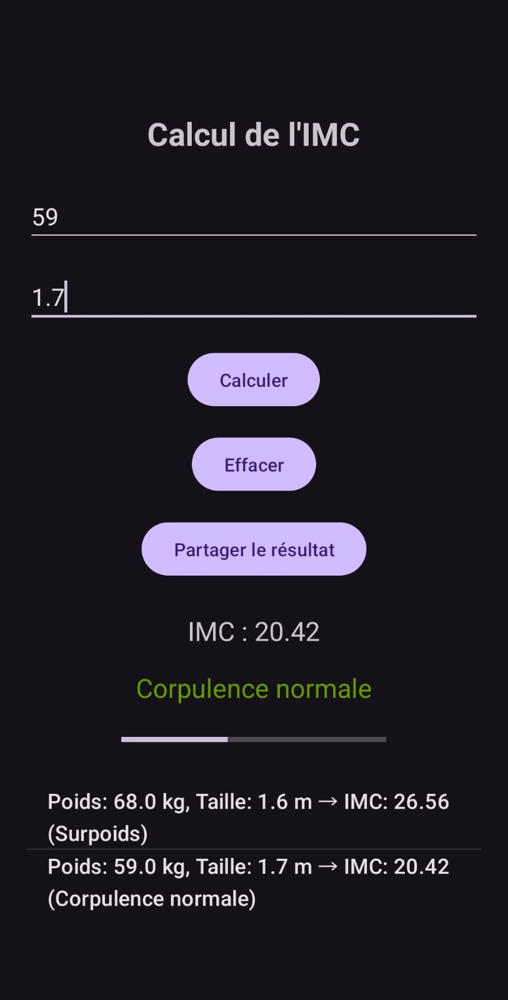
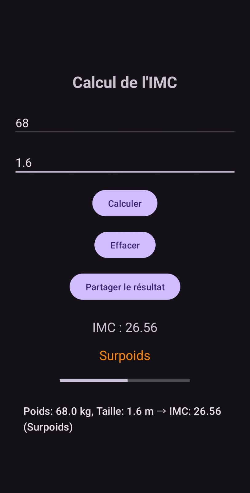
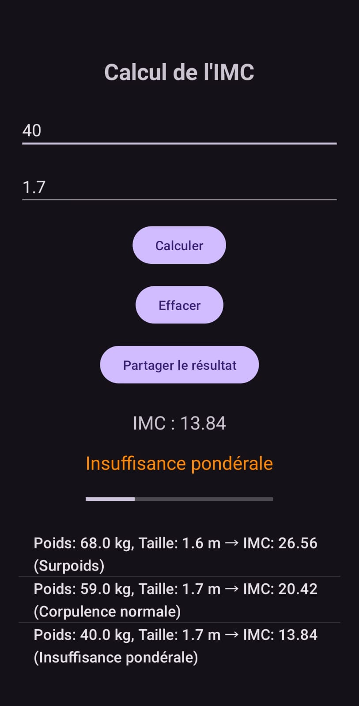
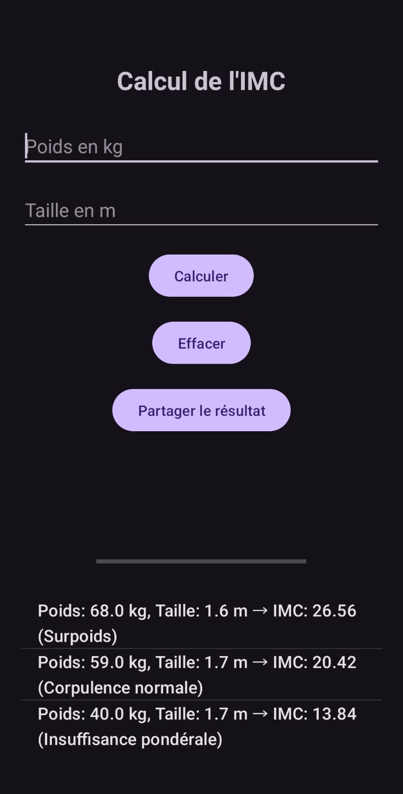

# Calcul IMC

Application Android permettant de calculer l’indice de masse corporelle (IMC) à partir du poids et de la taille, avec affichage de la catégorie correspondante.

## Fonctionnalités
- Saisie du poids et de la taille
- Calcul automatique de l’IMC
- Affichage de la catégorie (insuffisance pondérale, normal, surpoids, obésité…)
- Bouton Effacer pour réinitialiser les champs
- Messages d’erreur en cas de saisie incorrecte
- Interface simple et claire

## Technologies
- Kotlin, XML Layout
- Min SDK 24 / Target SDK 37
- Android Studio

## Installation
1. Cloner le dépôt
2. Ouvrir avec Android Studio
3. Lancer sur un émulateur ou un appareil physique

## Captures d’écran

## Auteur
Triki Mohamed Amine – ISET DJERBA / Groupe 2
